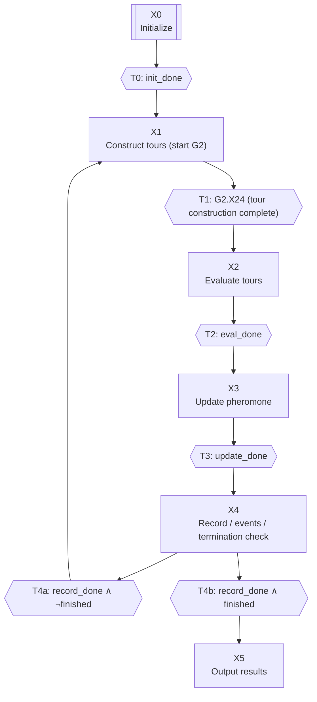
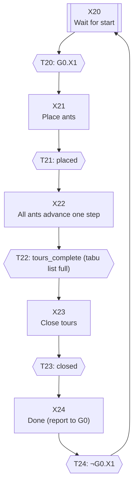
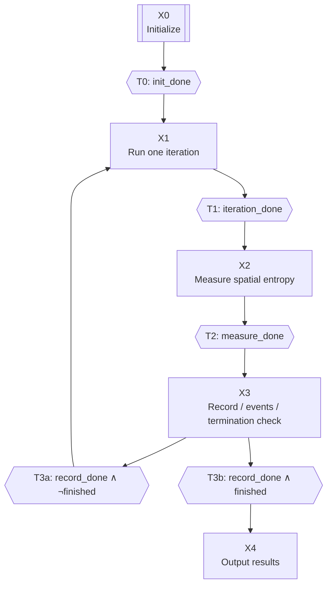
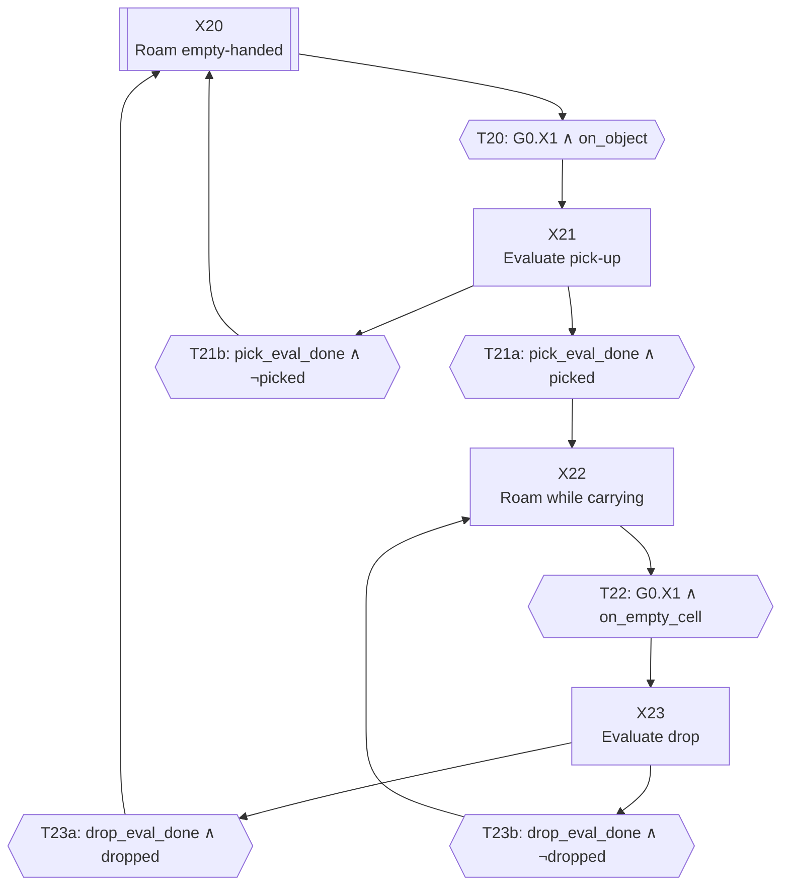
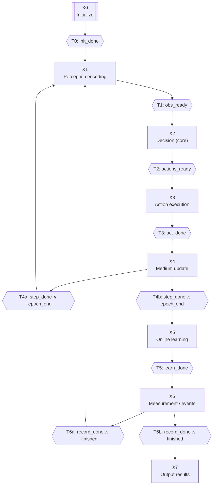
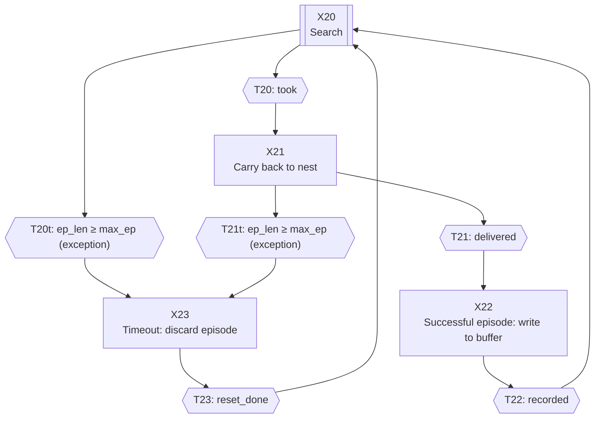

English | [中文](../zh-TW/GRAFCET_MODELS.md)

# GRAFCET Models (translation of an auto-generated file)

> This is an English translation of the generated file `docs/zh-TW/GRAFCET_MODELS.md`. Regenerate the Chinese file with `python docs/gen_model_docs.py` after changing a model, then update this translation.

The Chinese file is generated by `docs/gen_model_docs.py` from the model definitions in the code, which are the single source of truth. This English file is maintained by hand and must be updated whenever the generated file changes.

## Ant–TSP Optimization System

### Main controller (G0, IDEF0 A0, n=1)

Gate 2 model review: passed

| Step | IDEF0 | Action (mode) | Transition | Condition | Next state |
|---|---|---|---|---|---|
| X0 (init) | A1 | a1_initialize (P1) | T0 | init_done | X1 |
| X1 | A2 | — (N) | T1 | G2.X24 (tour construction complete) | X2 |
| X2 | A3 | a3_evaluate (P1) | T2 | eval_done | X3 |
| X3 | A4 | a4_update_pheromone (P1) | T3 | update_done | X4 |
| X4 | A5 | a5_record_and_events (P1) | T4a | record_done ∧ ¬finished | X1 |
| X4 | A5 | a5_record_and_events (P1) | T4b | record_done ∧ finished | X5 |
| X5 | A5 | a6_report (P1) | — | (terminal) | — |

### Tour-construction sub-controller (G2, IDEF0 A2, n=1)

Gate 2 model review: passed

| Step | IDEF0 | Action (mode) | Transition | Condition | Next state |
|---|---|---|---|---|---|
| X20 (init) | A2 | — (N) | T20 | G0.X1 | X21 |
| X21 | A21 | a21_place_ants (P1) | T21 | placed | X22 |
| X22 | A22 | a22_step_all_ants (N) | T22 | tours_complete (tabu list full) | X23 |
| X23 | A23 | a23_close_tours (P1) | T23 | closed | X24 |
| X24 | A2 | — (N) | T24 | ¬G0.X1 | X20 |

## Ant–Automatic Sorting System

### Main controller (G0, IDEF0 A0, n=1)

Gate 2 model review: passed

| Step | IDEF0 | Action (mode) | Transition | Condition | Next state |
|---|---|---|---|---|---|
| X0 (init) | A1 | a1_initialize (P1) | T0 | init_done | X1 |
| X1 | A2 | a_iteration_clock (N) | T1 | iteration_done | X2 |
| X2 | A3 | a3_measure (P1) | T2 | measure_done | X3 |
| X3 | A4 | a4_record_and_events (P1) | T3a | record_done ∧ ¬finished | X1 |
| X3 | A4 | a4_record_and_events (P1) | T3b | record_done ∧ finished | X4 |
| X4 | A4 | a5_report (P1) | — | (terminal) | — |

### Population controller (one isomorphic controller per ant) (G2, IDEF0 A2, n=40)

Gate 2 model review: passed

| Step | IDEF0 | Action (mode) | Transition | Condition | Next state |
|---|---|---|---|---|---|
| X20 (init) | A21 | a21_move (N) | T20 | G0.X1 ∧ on_object | X21 |
| X21 | A22 | a22_eval_pick (P1) | T21a | pick_eval_done ∧ picked | X22 |
| X21 | A22 | a22_eval_pick (P1) | T21b | pick_eval_done ∧ ¬picked | X20 |
| X22 | A21 | a21_move (N) | T22 | G0.X1 ∧ on_empty_cell | X23 |
| X23 | A23 | a23_eval_drop (P1) | T23a | drop_eval_done ∧ dropped | X20 |
| X23 | A23 | a23_eval_drop (P1) | T23b | drop_eval_done ∧ ¬dropped | X22 |

## microGPT Ant Foraging System

### Sensorimotor clock (G0, IDEF0 A0, n=1)

Gate 2 model review: passed

| Step | IDEF0 | Action (mode) | Transition | Condition | Next state |
|---|---|---|---|---|---|
| X0 (init) | A1 | a1_initialize (P1) | T0 | init_done | X1 |
| X1 | A21 | a21_perceive (P1) | T1 | obs_ready | X2 |
| X2 | A22 | a22_decide (P1) | T2 | actions_ready | X3 |
| X3 | A23 | a23_act (P1) | T3 | act_done | X4 |
| X4 | A3 | a3_medium (P1) | T4a | step_done ∧ ¬epoch_end | X1 |
| X4 | A3 | a3_medium (P1) | T4b | step_done ∧ epoch_end | X5 |
| X5 | A4 | a4_learn (P1) | T5 | learn_done | X6 |
| X6 | A5 | a5_record (P1) | T6a | record_done ∧ ¬finished | X1 |
| X6 | A5 | a5_record (P1) | T6b | record_done ∧ finished | X7 |
| X7 | A5 | a6_report (P1) | — | (terminal) | — |

### Task intention (population controller) (G2, IDEF0 A2, n=30)

Gate 2 model review: passed

| Step | IDEF0 | Action (mode) | Transition | Condition | Next state |
|---|---|---|---|---|---|
| X20 (init) | A2 | — (N) | T20t | ep_len ≥ max_ep (exception) | X23 |
| X20 (init) | A2 | — (N) | T20 | took | X21 |
| X21 | A2 | — (N) | T21t | ep_len ≥ max_ep (exception) | X23 |
| X21 | A2 | — (N) | T21 | delivered | X22 |
| X22 | A4 | a24_record_success (P1) | T22 | recorded | X20 |
| X23 | A2 | a25_reset_timeout (P1) | T23 | reset_done | X20 |

